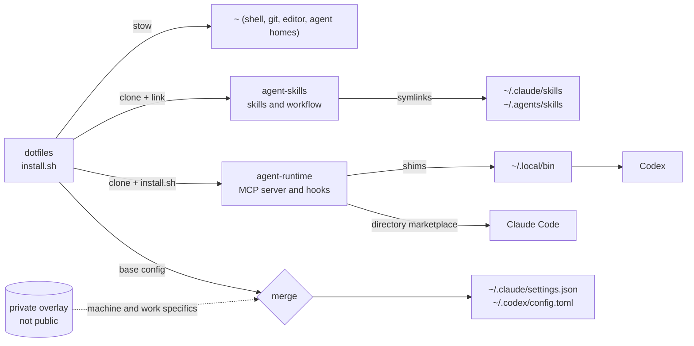

# dotfiles

[](https://github.com/FBisca/dotfiles/actions/workflows/ci.yml)

My macOS setup, managed with [GNU Stow](https://www.gnu.org/software/stow/): shell, editor, git, terminal and the configuration for Claude Code and Codex. One `./install.sh` rebuilds it on a new machine, and it is idempotent, so it is also how I update this one.

It started as a fork of [rodrigopsasaki](https://github.com/rodrigopsasaki)'s dotfiles; thanks to him for the original structure.

## What is here

| Module | Contents |
|---|---|
| `git` | aliases, delta diffs, scoped identity overrides ([readme](git/README.md)) |
| `zsh` | modular config sourced from `.zshrc`, fzf, a git-ignored secrets loader ([readme](zsh/README.md)) |
| `nvim` | Lua config; lazy.nvim bootstraps itself ([readme](nvim/README.md)) |
| `mise`, `gh`, `fzf`, `env` | runtimes, GitHub CLI, fuzzy finder, environment ([mise](mise/README.md), [gh](gh/README.md)) |
| `kitty`, `wezterm`, `slack` | terminal and app settings |
| `agents` | Claude Code, Codex and Pi: base settings, custom agents, status line, instructions |
| `bin` | small scripts on `PATH`, e.g. `wait-checks` (block until a PR's checks finish) |

## How it fits together

Agent tooling is split across repositories so each part can be used on its own. This repo wires them to one machine.



- [`agent-skills`](https://github.com/FBisca/agent-skills): the skills that take an idea to a spec, a plan and an orchestrated build.
- [`agent-runtime`](https://github.com/FBisca/agent-runtime): the MCP server that lets Claude Code and Codex delegate work to other agents.
- A private overlay holds what must not be public: auto-mode context, work paths, machine state.

## Install

Requirements: macOS, [`stow`](https://www.gnu.org/software/stow/), `git`, `python3` 3.11+, and [`gh`](https://cli.github.com/) authenticated with `gh auth login`.

```sh
git clone https://github.com/FBisca/dotfiles ~/developer/dotfiles
cd ~/developer/dotfiles
./install.sh
```

`install.sh` does five things, in order:

1. Clones `agent-skills` and `agent-runtime` into `~/developer` if they are missing.
2. Makes `~/.claude/skills` and `~/.agents/skills` real directories and symlinks every skill into both, so `npx skills add` installs and claude.ai's synced skills never write into a repo. An older symlinked layout is migrated: claude.ai's `synced/` and other real skills are moved over, and stale copies or build leftovers go to a timestamped folder under `~/.dotfiles-backup`. Nothing is deleted. If the old `dotfiles` Claude marketplace is still registered, the installer prints the one command that removes it.
3. Runs agent-runtime's installer, which links its shims into `~/.local/bin`.
4. Generates `~/.claude/settings.json` and `~/.codex/config.toml` from the tracked base files plus the private overlay (below).
5. Sets Pi up: `~/.pi/agent/settings.json` from `agents/.pi/settings.base.json` plus the private overlay, and reports the skills Pi will find. It never writes credentials and never installs the Pi binary.
6. Stows every module.

Options: `--upstream` also reinstalls the upstream skills that `agent-skills` lists in its lock file (`scripts/install-upstream.sh`), such as `impeccable`, the current upstream of the former `frontend-design` skill; `--no-stow` skips Stow; `--pi-only` links the skills and sets Pi up, leaving Claude Code and Codex alone. Directories and clone URLs are overridable with `AGENT_SKILLS_DIR`, `AGENT_RUNTIME_DIR`, `AGENT_FLEET_DIR`, `AGENT_SKILLS_REPO` and `AGENT_RUNTIME_REPO` (see `./install.sh --help`).

### Private overlay

Public base config lives in `agents/.claude/settings.base.json` and `agents/.codex/config.base.toml`. Anything machine- or work-specific goes in an overlay kept outside this repo: `claude-settings.json` and `codex-config.toml` under `$DOTFILES_PRIVATE` (default `~/developer/agent-fleet/overlay`). Claude's overlay also falls back to `~/.claude/private-overlay/settings.overlay.json`. The overlay is optional; without it the live files equal the base. Pi has its own overlay file there, `pi-settings.json` (see [Pi](#pi)).

`scripts/merge-config.py` deep-merges them: tables merge, arrays concatenate, later values win. A key ending in `!` in the overlay (`"args!" = [...]`) replaces the base value instead of concatenating, for argv-like arrays that must not grow. The result is parsed back before it atomically replaces the live file, so a bad overlay fails the install and leaves the existing file alone.

Both live files are generated, so edit the base or the overlay, not them. The tools do write into their own config at runtime, and re-running the installer does not revert that: when the live file is a regular file, these tables are carried over from it, live entries winning and base or overlay entries it lacks staying.

| File | Carried over from the live file |
|---|---|
| `~/.codex/config.toml` | `projects` (trust), `hooks.state` (trusted hook hashes), `notice`, `tui`, `plugins`, `marketplaces` |
| `~/.claude/settings.json` | `enabledPlugins`, `extraKnownMarketplaces`, `permissions` |

Anything else in a live file, including a `model` changed mid-session, is regenerated from the base and overlay. If the result differs from the live file, the previous copy is saved next to it as `*.bak-<timestamp>` first.

## Agent tooling

Claude Code and Codex are configured from `agents/`:

- `settings.base.json` and `config.base.toml`: shared defaults, merged with the overlay as above. Claude's default effort is `medium`; `modelSettings` sets each model's own level, keyed by the canonical id (`claude-sonnet-5-5`, not `claude-sonnet-5`). A model without an entry runs at the default.
- `.codex/worker.config.toml`: the profile agent-runtime gives Codex workers (`codex -p worker`): `gpt-6.1-terra` at medium effort. Codex reads a worker's model and effort from this file, not from `agents/implementer.toml`.
- `.config/agent-runtime/`: agent-runtime's launch profiles (`minimax` runs a Claude worker on MiniMax-M3.1-Flash) and that profile's permission allowlist. The API key stays a `$MINIMAX_API_KEY` reference.
- `agents/` in each home: custom agents, such as the `implementer` that orchestrated builds delegate to.
- `.claude/statusline.sh`: the status line (model, context bar, tokens used, effort).
- `.agents/AGENTS.md`: shared instructions, linked into both tools.

Skills and the workflow they implement come from [`agent-skills`](https://github.com/FBisca/agent-skills); its [workflow guide](https://github.com/FBisca/agent-skills/blob/main/docs/workflow.md) explains idea, spec, plan, build. Delegation comes from [`agent-runtime`](https://github.com/FBisca/agent-runtime): Claude loads the plugin in place from `~/developer/agent-runtime` as a directory marketplace, so edits apply at the next Claude/Codex session. There is no update step, and version bumps are record-only. Codex reaches the same server and PreToolUse hook through `$HOME/.local/bin/agent-runtime-mcp` and `agent-runtime-hook`. The `codex()` shell wrapper adds `--no-daemon` inside Herdr terminals.

## Pi

[Pi](https://pi.dev) is a standalone harness that runs beside Claude Code and Codex. Its own installer owns the binary (`curl -fsSL https://pi.dev/install.sh | sh`); this repo never installs or updates it. `install.sh` only manages the user's Pi preferences, and only additively:

- `agents/.pi/settings.base.json` is the tracked Pi base, merged into `~/.pi/agent/settings.json`.
- `$DOTFILES_PRIVATE/pi-settings.json` is the optional private overlay for the provider and model choices (`defaultProvider`, `defaultModel`, `defaultThinkingLevel`); `agents/.pi/pi-settings.example.json` is a starting point. Provider, model and endpoint choices are machine-specific, so they stay out of the tracked files.
- The live `~/.pi/agent/settings.json` belongs to the user: base and overlay are merged *under* it, so whatever Pi or the user wrote there survives. A file that is not valid JSON is backed up as `settings.json.bak-<timestamp>` and left untouched.
- Skills are not copied or forked. Pi discovers the symlinks in `~/.agents/skills` that the installer already links, and the installer reports the skills it found and the ones that are missing (a missing skill is reported, never invented).
- No credentials are written. Authorise a provider inside Pi with `/login`, or export `MINIMAX_API_KEY` and let Pi read it from the environment; `auth.json` is never touched.
- Pi has no permission prompts, so the `agent-runtime` MCP server is removed from `~/.pi/agent/mcp.json` (other servers stay and the previous file is backed up) until a safety adapter is approved.

`./install.sh --pi-only` links the skills and sets Pi up without touching Claude Code or Codex.

### Manual checks

These need the real machine and an authorised provider, so they are not covered by the automated tests (see `docs/plans/2026-11-07-pi-bootstrap.plan.md`):

- [ ] `pi --version` reports the installed Pi.
- [ ] `pi auth check --provider minimax --model MiniMax-M3.1-Flash` reports the credential as resolved.
- [ ] `/login` (or `MINIMAX_API_KEY`) authorises MiniMax and `/model` selects `MiniMax-M3.1-Flash` with low reasoning.
- [ ] `/skill:start-planning` loads the skill from `~/.agents/skills/start-planning`.
- [ ] A bounded code edit in a disposable worktree finishes without the model repeating the same tool call.
- [ ] No agent-runtime tool is exposed in Pi.

## Tests and CI

```sh
python3 -B -m unittest discover -s tests
```

The tests are contracts between this repo and what it consumes: the Codex wiring and Claude settings that load the runtime, the implementer agents' tool lists, the `codex()` wrapper, and `install.sh` run against a temporary `HOME` (skills linking and migration, config merge with and without an overlay, and the Pi bootstrap: additive settings, skill discovery, secret safety and no runtime MCP in Pi). Set `AGENT_RUNTIME_SRC` to a local `agent-runtime` checkout to also run the tests that launch the real server. CI runs these, `shellcheck` on `install.sh` and `bin/`, and a `stow -n` dry run on macOS.

## Layout

```
dotfiles/
├── agents/      # Claude Code, Codex and Pi config, agents, status line
├── bin/         # scripts on PATH via ~/bin
├── scripts/     # merge-config.py
├── tests/       # contract and installer tests
├── git/ zsh/ nvim/ mise/ gh/ fzf/ env/ kitty/ wezterm/ slack/
└── install.sh
```

## License

[MIT](LICENSE)
