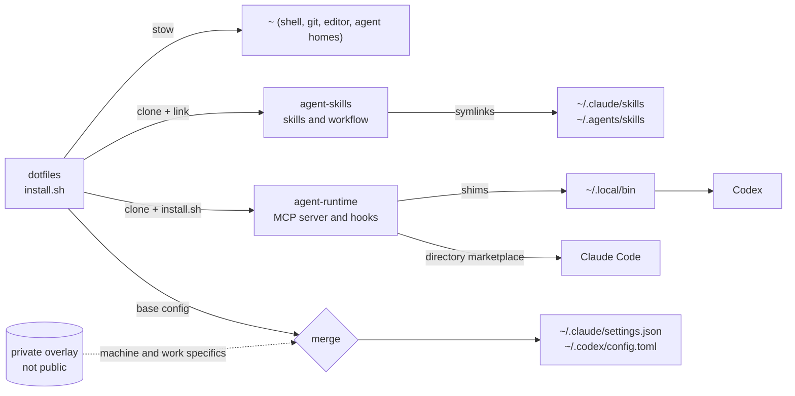

# dotfiles

[](https://github.com/FBisca/dotfiles/actions/workflows/ci.yml)

My macOS setup, managed with [GNU Stow](https://www.gnu.org/software/stow/): shell, editor, git, terminal and the configuration for Claude Code and Codex. One `./install.sh` rebuilds it on a new machine, and it is idempotent, so it is also how I update this one.

It started as a fork of [rodrigopsasaki](https://github.com/rodrigopsasaki)'s dotfiles; thanks to him for the original structure.

## What is here

| Module | Contents |
|---|---|
| `git` | aliases, delta diffs, scoped identity overrides ([readme](git/README.md)) |
| `zsh` | modular config sourced from `.zshrc`, fzf, a git-ignored secrets loader ([readme](zsh/README.md)) |
| `nvim` | Lua config; lazy.nvim bootstraps itself ([readme](nvim/README.md)) |
| `mise`, `gh`, `fzf`, `env` | runtimes, GitHub CLI, fuzzy finder, environment ([mise](mise/README.md), [gh](gh/README.md)) |
| `kitty`, `wezterm`, `slack` | terminal and app settings |
| `agents` | Claude Code and Codex: base settings, custom agents, status line, instructions |
| `bin` | small scripts on `PATH`, e.g. `wait-checks` (block until a PR's checks finish) |

## How it fits together

Agent tooling is split across repositories so each part can be used on its own. This repo wires them to one machine.



- [`agent-skills`](https://github.com/FBisca/agent-skills): the skills that take an idea to a spec, a plan and an orchestrated build.
- [`agent-runtime`](https://github.com/FBisca/agent-runtime): the MCP server that lets Claude Code and Codex delegate work to other agents.
- A private overlay holds what must not be public: auto-mode context, work paths, machine state.

## Install

Requirements: macOS, [`stow`](https://www.gnu.org/software/stow/), `git`, `python3` 3.11+, and [`gh`](https://cli.github.com/) authenticated with `gh auth login`.

```sh
git clone https://github.com/FBisca/dotfiles ~/developer/dotfiles
cd ~/developer/dotfiles
./install.sh
```

`install.sh` does five things, in order:

1. Clones `agent-skills` and `agent-runtime` into `~/developer` if they are missing.
2. Makes `~/.claude/skills` and `~/.agents/skills` real directories and symlinks every skill into both, so `npx skills add` installs and claude.ai's synced skills never write into a repo. An older symlinked layout is migrated and its contents are moved, never deleted.
3. Runs agent-runtime's installer, which links its shims into `~/.local/bin`.
4. Generates `~/.claude/settings.json` and `~/.codex/config.toml` from the tracked base files plus the private overlay (below).
5. Stows every module.

Options: `--upstream` also reinstalls the upstream skills that `agent-skills` lists in its lock file (`scripts/install-upstream.sh`); `--no-stow` skips Stow. Directories and clone URLs are overridable with `AGENT_SKILLS_DIR`, `AGENT_RUNTIME_DIR`, `AGENT_FLEET_DIR`, `AGENT_SKILLS_REPO` and `AGENT_RUNTIME_REPO` (see `./install.sh --help`).

### Private overlay

Public base config lives in `agents/.claude/settings.base.json` and `agents/.codex/config.base.toml`. Anything machine- or work-specific goes in an overlay kept outside this repo: `claude-settings.json` and `codex-config.toml` under `$DOTFILES_PRIVATE` (default `~/developer/agent-fleet/overlay`). Claude's overlay also falls back to `~/.claude/private-overlay/settings.overlay.json`. The overlay is optional; without it the live files equal the base.

`scripts/merge-config.py` deep-merges them: tables merge, arrays concatenate, later values win. The result is parsed back before it atomically replaces the live file, so a bad overlay fails the install and leaves the existing file alone. If a live file differs from what was generated (Codex rewrites its own config), the previous copy is saved next to it as `*.bak-<timestamp>` first. Both live files are generated, so edit the base or the overlay, not them.

## Agent tooling

Claude Code and Codex are configured from `agents/`:

- `settings.base.json` and `config.base.toml`: shared defaults, merged with the overlay as above.
- `agents/` in each home: custom agents, such as the `implementer` that orchestrated builds delegate to.
- `.claude/statusline.sh`: the status line (model, context bar, tokens used).
- `.agents/AGENTS.md`: shared instructions, linked into both tools.

Skills and the workflow they implement come from [`agent-skills`](https://github.com/FBisca/agent-skills); its [workflow guide](https://github.com/FBisca/agent-skills/blob/main/docs/workflow.md) explains idea, spec, plan, build. Delegation comes from [`agent-runtime`](https://github.com/FBisca/agent-runtime): Claude loads the plugin in place from `~/developer/agent-runtime` as a directory marketplace, so edits apply at the next Claude/Codex session. There is no update step, and version bumps are record-only. Codex reaches the same server and PreToolUse hook through `$HOME/.local/bin/agent-runtime-mcp` and `agent-runtime-hook`. The `codex()` shell wrapper adds `--no-daemon` inside Herdr terminals.

## Tests and CI

```sh
python3 -B -m unittest discover -s tests
```

The tests are contracts between this repo and what it consumes: the Codex wiring and Claude settings that load the runtime, the implementer agents' tool lists, the `codex()` wrapper, and `install.sh` run against a temporary `HOME` (skills linking and migration, config merge with and without an overlay). Set `AGENT_RUNTIME_SRC` to a local `agent-runtime` checkout to also run the tests that launch the real server. CI runs these, `shellcheck` on `install.sh` and `bin/`, and a `stow -n` dry run on macOS.

## Layout

```
dotfiles/
├── agents/      # Claude Code and Codex config, agents, status line
├── bin/         # scripts on PATH via ~/bin
├── scripts/     # merge-config.py
├── tests/       # contract and installer tests
├── git/ zsh/ nvim/ mise/ gh/ fzf/ env/ kitty/ wezterm/ slack/
└── install.sh
```

## License

[MIT](LICENSE)
